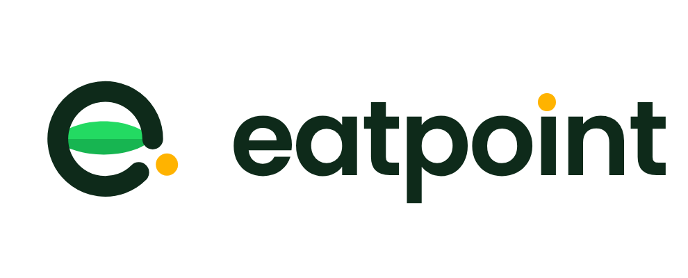
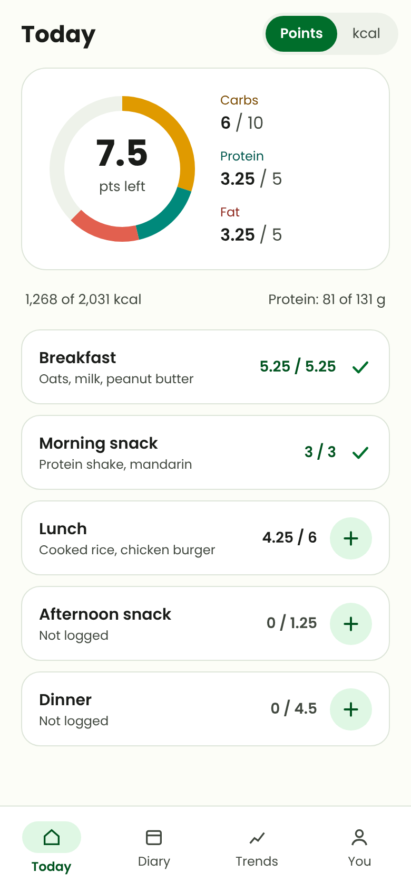
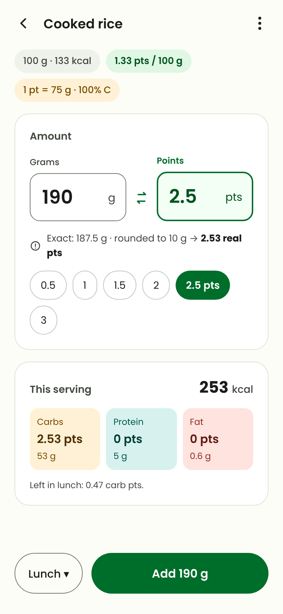
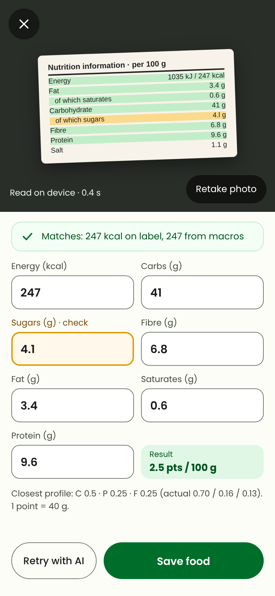
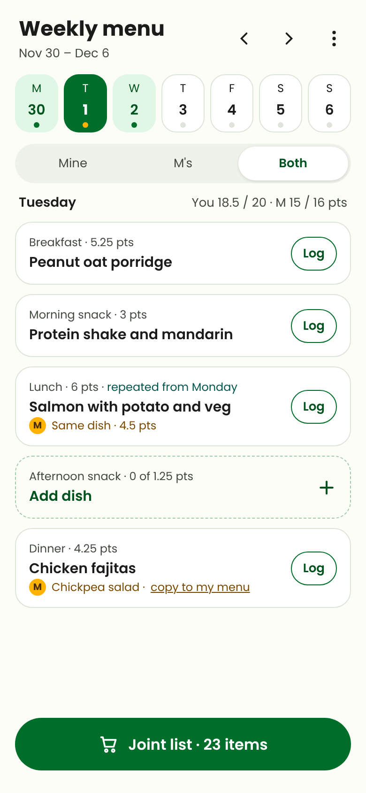
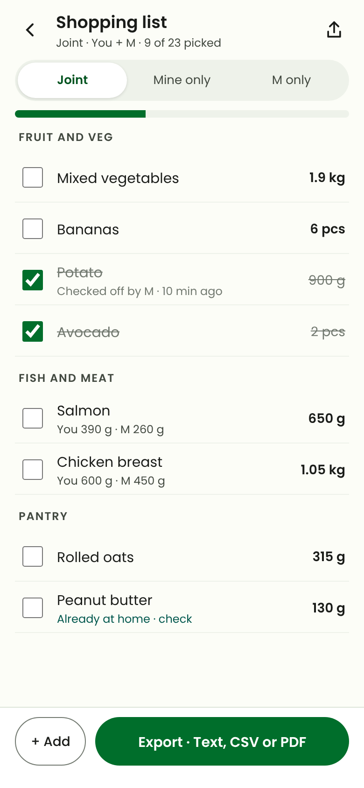
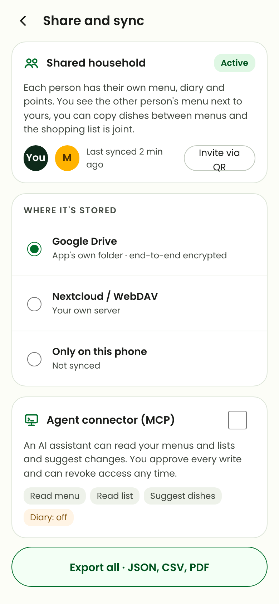

<p align="center">
  <picture>
    <source media="(prefers-color-scheme: dark)" srcset="assets/icon/eatpoint_banner_top_light.png">
    
  </picture>
</p>

<p align="center">
  A fork of <a href="https://github.com/simonoppowa/OpenNutriTracker">OpenNutriTracker</a> that adds
  points ↔ grams tracking, weekly menus with a shared shopping list, and nutrition-label scanning.
</p>

> [!NOTE]
> **EatPoint is a fork of [OpenNutriTracker](https://github.com/simonoppowa/OpenNutriTracker)**,
> created by Simon Oppowa and its contributors, and is distributed under the same
> [GPLv3 license](LICENSE). The changes this fork makes are described in
> [What EatPoint adds](#what-eatpoint-adds) and shown in the [Screenshots](#screenshots).
> Everything else in this README describes the upstream app, which the fork keeps intact.
> The store links, release and build badges, translation platform and contact details below
> belong to the upstream project.

<p align="center">
  <b>Free. Open. Cited.</b><br />
  Open-source calorie, macro, and micronutrient logging for Android and iOS.
</p>

<p align="center">
  <a href="LICENSE"></a>
  <a href="https://github.com/simonoppowa/OpenNutriTracker/releases"></a>
  <a href="https://github.com/simonoppowa/OpenNutriTracker/actions/workflows/default_workflow.yml"></a>
  
  <a href="https://hosted.weblate.org/engage/opennutritracker/"></a>
  <a href="https://github.com/simonoppowa/OpenNutriTracker/stargazers"></a>
  <a href="https://github.com/simonoppowa/OpenNutriTracker/issues"></a>
  <a href="https://github.com/simonoppowa/OpenNutriTracker/pulls"></a>
</p>

<p align="center">
  <a href="https://trendshift.io/repositories/12625"></a>
  &nbsp;
  <a href="https://trendshift.io/repositories/12625"></a>
</p>

<p align="center">
  <a href="GettingStarted.md">Getting started</a>
  ·
  <a href="CONTRIBUTING.md">Contributing</a>
  ·
  <a href="https://hosted.weblate.org/engage/opennutritracker/">Translate</a>
</p>

OpenNutriTracker logs what you eat and drink against a calorie and macro target it works
out from your height, weight, age, and activity level, and keeps the record on your phone.
It is for anyone who wants the numbers without handing their eating history to a company,
whether that is losing weight, gaining it, managing a condition, or simply knowing.

## What EatPoint adds

> **Status:** first preview release, v0.1.0 ([Releases](https://github.com/Grohle/EatPoint/releases)). Features marked *in development* are not in it yet.

EatPoint adds a portion system on top of OpenNutriTracker's calorie and macro tracking. You
can plan and log meals in **points** as well as in grams. The new flows are the default; the
original calorie-first screens stay available from the menu.

| | |
| :-- | :-- |
| **Points ↔ grams** | One point is 100 kcal from a single macronutrient. Each food carries how its points split between carbs, protein and fat, so a meal can be planned in points and weighed in grams. Daily and per-meal point budgets come from your calorie and macro targets, with protein set first. |
| **Point budget per meal** | You give each meal its own budget of carb, protein and fat points (for example breakfast 3 / 0.25 / 2, lunch 3 / 2 / 1), and the meals add up to the day's total. While you plan or log, every meal shows what it has used and what is left. |
| **Suggested starting budget** | When you enter your weight, height, age, activity and goal (and, optionally, waist and neck measurements for a body-fat estimate), the app suggests a daily point budget and a split across meals. The suggestion is always labelled as **a guide only**: a starting point to adjust as you track your progress, not medical or dietetic advice. You can edit every number. |
| **Two-way amount entry** | When you log a food, the grams and points fields stay in sync. Typing grams updates the points. Typing points fills in practical grams for a kitchen scale (to 1 g under 30 g, to 5 g up to 150 g, to 10 g above that) and shows the exact value next to it. |
| **Points in the daily summary** | The day's points used and remaining appear next to calories and macros. |
| **Nutrition-label scanner** | For products that aren't in the food databases, you can photograph the label. On-device text recognition reads the per-100 g / 100 ml values in Spanish and English, checks the calories against the macros, and opens an editor beside the photo so you can correct anything before saving. |
| **Optional AI extraction** | If the on-device read doesn't add up, you can retry with the vision model you configured for AI assistance (Anthropic, OpenAI, OpenRouter or your own OpenAI-compatible server). The app asks before each photo is sent, and nothing leaves the phone otherwise. A downloadable on-device model is *in development*. |
| **Weekly menu planner** | A separate planner lays out the week by day and meal. You can fill it with dishes you've logged or saved before (recipes, favourites, recent meals) and see each day's points against its budget. A planned meal can be logged in one tap. |
| **Shopping list** | The planner builds a shopping list from the week's menus. Quantities are merged per ingredient and grouped by aisle. Each item can be ticked off, and the list can be shared or exported as text or CSV. Both the planner and the list are one tap away from the home screen. |
| **Scheduled reminders** | Optional local notifications remind you to plan the week, to do the shopping, and to prepare or log each planned meal, at times you choose. They are off until you turn them on. |
| **Shared household** | Optionally link your app with another person's. Each person keeps their own weekly menu, diary and point budget. Your menus are merged: you see the other person's menu next to yours, can copy dishes between them, and get one **joint shopping list** that adds up both menus per ingredient and shows who each quantity is for. Ticking an item off shows up on both phones. Data syncs through storage you choose: your own Supabase project (the app can create the database for you), a Nextcloud/WebDAV folder, or your own Ubuntu server, where the app installs a small sync service over SSH. Everything is end-to-end encrypted (AES-256-GCM): the key is exchanged in person by QR code, so the storage only ever holds ciphertext. Google Drive is *in development*. |
| **Agent connector (MCP)** | An optional [Model Context Protocol](https://modelcontextprotocol.io) server runs on the phone itself while the app is open, so any MCP client on your Wi‑Fi can connect with the address and token the app shows (it copies a ready-made client configuration). Agents can read your points budget, menus, shopping list and dishes; they can only *propose* changes, which wait for your approval in the app. Reading the diary is off unless you allow it. |
| **Export everything** | EatPoint's data (points settings, menus, shopping lists, reminders) exports to and imports from a JSON file; the shopping list also shares as text or CSV, and the week's menu as text. The diary keeps the upstream JSON/CSV export. |
| **English and Spanish** | Every new screen, message and export ships in English and Spanish from the start, using the app's existing localization files. Other languages show English until they are translated. |
| **Isolated from upstream** | The new logic lives in its own modules. Calorie, macro and BMI calculations and the Open Food Facts integration behave as they do upstream. |

## Install

<p align="center">
  <a href="https://apps.apple.com/us/app/opennutritracker/id6451490901"></a>
  &nbsp;&nbsp;
  <a href="https://play.google.com/store/apps/details?id=com.opennutritracker.ont.opennutritracker"></a>
</p>

## Screenshots

<table align="center">
  <tr>
    <td align="center" width="33%"></td>
    <td align="center" width="33%"></td>
    <td align="center" width="33%"></td>
  </tr>
  <tr>
    <td align="center"><sub><b>Today</b><br />points left, meal by meal</sub></td>
    <td align="center"><sub><b>Add food</b><br />grams ↔ points</sub></td>
    <td align="center"><sub><b>Label scanner</b><br />photo to food in one step</sub></td>
  </tr>
  <tr>
    <td align="center"></td>
    <td align="center"></td>
    <td align="center"></td>
  </tr>
  <tr>
    <td align="center"><sub><b>Weekly menu</b><br />yours and theirs, together</sub></td>
    <td align="center"><sub><b>Shopping list</b><br />one list for the household</sub></td>
    <td align="center"><sub><b>Share &amp; sync</b><br />private by design</sub></td>
  </tr>
</table>

<sub>Design previews of EatPoint's screens with example data. The app is in development, so the final screens may differ.</sub>

## Why OpenNutriTracker

|  | |
| :-- | :-- |
| **Cited** | Calorie targets follow IOM 2005, BMI follows WHO, macros follow WHO TRS 916, activity burn follows the 2024 Compendium. The in-app Sources & References screen links every paper ([`sources_screen.dart`](lib/core/presentation/sources_screen.dart)). |
| **Careful** | The fasting timer opens with a content warning linking BEAT and NEDA, and "Not for me" is a first-class answer ([`fasting_warning_dialog.dart`](lib/features/fasting/presentation/widgets/fasting_warning_dialog.dart)). No streak guilt, and no notification you didn't ask for. The daily reminder is off until you enable it. |
| **Free** | No paid tier and no ads, with zero advertising or analytics SDKs in [`pubspec.yaml`](pubspec.yaml) to add them with. That includes the micronutrient panel the big-name trackers put behind a subscription. No investors, and GPLv3 leaves no exit that could paywall it later. |
| **Private** | No account to create. Your diary lives in AES-256-encrypted storage with the key held in the Android Keystore / iOS Keychain, every destination that receives a request is listed under [Privacy](#privacy) with what it's sent, and the release signing fingerprint is published so you can verify your download. |
| **Portable** | Export your diary, activities, tracked days, recipes, weight history and custom activity templates as JSON — or diary, activities and tracked days as CSV — re-import it, or share an entry by QR. The [export format](docs/export-format.md) documents the schema and what it leaves out. |
| **Open** | Open Food Facts, USDA FoodData Central (CC0) and the German BLS (CC BY 4.0). The backend is its own open repository you can [self-host](docs/supabase-self-hosting.md). |
| **Community driven** | Over 30 developers have already contributed code, and most merged pull requests come from someone other than the maintainer. Features and fixes arrive as user issues and PRs, across the app and its food backend, and every translation is contributed on [Weblate](https://hosted.weblate.org/engage/opennutritracker/), which needs no Dart and no local setup. |
| **Inclusive** | Non-binary calorie estimation grounded in published trans-health research, eleven languages, kcal or kJ, and screen-reader support treated as a bug when it breaks. |

## Key features

|  | Feature | |
| :--: | :-- | :-- |
| 🍎 | **Food logging** | Search, scan a barcode, or quick-add kcal, backed by Open Food Facts, USDA, and German BLS. |
| 📓 | **Food diary** | Breakfast, Lunch, Dinner, and Snack on a calendar, with per-meal kcal targets. |
| 📈 | **Trends** | Streaks, calories against your goal line, macro averages, water, and weight over time. |
| 🥕 | **Micronutrients** | Day and week views for ten nutrients, with optional reference-intake bars. |
| 🍽️ | **Meals and recipes** | Reusable recipes with photo, brand, and barcode. |
| 🏃 | **Activities and weight** | Workout catalogue or custom activities; weight trend against a target. |
| 💧 | **Water and fasting** | A home-screen water chip and an optional intermittent-fasting timer. |
| 🎨 | **Themes and units** | Material You accent on Android 12+, sixteen built-in themes, kcal or kJ. |
| 📤 | **Export and import** | JSON and CSV export, JSON import, and QR sharing. |

<details>
<summary>More detail on each feature</summary>

- **🍎 Nutritional tracking:** Log meals and snacks against a large food database: Open Food Facts plus a multi-source reference backend covering USDA FoodData Central and the German Bundeslebensmittelschlüssel (BLS), with the sources selectable in Settings → Food databases. Each entry can be searched, scanned, or added straight as a number when you already know the calorie cost.
- **📓 Food diary:** A calendar-driven diary that breaks the day into Breakfast, Lunch, Dinner, and Snack, with per-meal kcal targets (Standard, OMAD, Five-small, Mediterranean, Two-meal, or a custom share), drag-to-rearrange between meals, and sort by time or by macro contribution.
- **📈 Trends:** A current and best day-streak card, calories charted against your goal line, daily macro averages, water intake, and weight against target with an estimate of the weeks left to reach it. Switch the window between 7, 30 and 90 days or your whole history.
- **🥕 Micronutrient panel:** Day and week views for fibre, sodium, saturated fat, sugar, calcium, iron, potassium, vitamin D, vitamin B12, and magnesium, with optional Dietary Reference Intake bars from the IOM tables so you can see where you sit against the reference range.
- **🍽️ Custom meals + recipes:** Build a one-off custom meal or save a reusable recipe with photo, brand, and barcode. The recipe builder has its own ingredient picker with barcode scanning so you can compose meals from real products without leaving the screen.
- **⚡ Quick add:** When you already know roughly how much you ate, skip the search flow entirely. Quick add takes a title plus kcal (and optional macros) and logs it straight to the meal section.
- **📷 Barcode scanner:** Scan packaged items for instant lookup, paste a barcode manually when the camera struggles, or attach a barcode to a custom meal so future scans recognise your own foods.
- **🏃 Activities:** Log workouts from a categorised activity catalogue or define your own custom activities with direct kcal entry and reusable templates.
- **💧 Water tracker:** A water chip on the home screen with quick-add increments, an editable goal, and undo for the last entry.
- **⏱️ Fasting timer:** Optional intermittent-fasting timer with content-warning gate, a home chip showing time remaining, and a completion notification when you reach your window.
- **⚖️ Weight history:** Capture weight during onboarding and on demand, see the trend on a chart with a dashed line at your target weight, and optionally taper the calorie goal as you approach it.
- **🎨 Material You + theme picker:** Adopt the system accent colour on Android 12+, or pick from sixteen built-in presets. The app icon adapts to iOS dark and tinted appearances and to Android themed icons.
- **🔢 kcal or kJ:** Switch the energy unit globally; every diary entry, target, and chart reflects the choice.
- **📤 Export and import:** Export your diary entries, activities, tracked days, recipes, weight history and custom activity templates to a JSON zip (recipe and custom-meal photos included), or diary, activities and tracked days as a CSV zip — you pick one format, the bundle carries only that one ([bundle format](docs/export-format.md)). Paste a JSON blob to import meals, and share a single meal or activity as a QR code another phone can scan. Your profile, custom-meal catalogue, water and fasting history stay out of the bundle.

</details>

## Privacy

No account, no sign-in, no analytics, no ads. Your profile, diary, activities, weight, water and fasting history, custom meals, and recipes live in local [Hive](https://pub.dev/packages/hive_ce) boxes encrypted with AES-256. The key is generated on first launch, kept in the Android Keystore / iOS Keychain, and never transmitted ([source](lib/core/utils/secure_app_storage_provider.dart)). **Settings → Delete all my data** wipes the active profile. Formal policy: [Data Protection](https://www.iubenda.com/privacy-policy/53501884).

**What leaves your device.** These destinations, nothing else, and the last five only if you turn them on — plus one more, set out below, if you point the app at a server of your own:

| Destination | When | What is sent |
| :-- | :-- | :-- |
| [Open Food Facts](https://world.openfoodfacts.org/) | Food search, barcode scan, or whenever a food's photograph is shown — in search results, on a meal screen, and on the diary card of a meal you have already logged | The search term or barcode. A word search also sends your device's **language** code to rank results; the fallback search and the barcode lookup send no locale at all. Your **country is never sent** — the country boost is applied on your device, to the results that come back. A photograph's address contains that product's barcode. Searches and product lookups identify the app by name, platform and version; photograph downloads do not |
| Supabase reference backend | Food search | The text you typed; your **device's** language code, when it is one the backend has food names in; and which food databases you have left switched on — that list travels on every search, because onboarding starts one of the five off |
| App Store (iOS) / Google Play (Android) | Opening Settings → About → Support OpenNutriTracker, and leaving a tip there. On Android also at every start, to finish a tip an earlier run left open | A request for the three tips' store prices. A tip's payment goes to Apple or Google and never passes through the app, which sees only the tip's product ID, the purchase status and a purchase token it does not store |
| [Anthropic](https://www.anthropic.com/) | **Only if you save your own API key and pick Anthropic** | The meal line you type on the multi-item add screen, or a meal photo you choose to read there, and your app language |
| [OpenAI](https://openai.com/) | **Only if you save your own API key and pick OpenAI** | As the Anthropic row, plus the model you chose |
| [OpenRouter](https://openrouter.ai/) | **Only if you save your own API key and pick OpenRouter** | As the Anthropic row, plus the model you chose |
| └ the vendor serving it | | Named in Settings; pinned, so it is the vendor the model names |
| [Google Gemini API](https://ai.google.dev/gemini-api/terms) | **Only if you enter Google's Gemini address (`generativelanguage.googleapis.com`) as your own server** — from the moment you type it, as the own-server row below describes | As that row: the meal line or photo, your app language, and the model name you typed. Google receives it under its Gemini API terms: on unpaid use it may use it to improve its products and machine learning, and human reviewers may read it; on paid use, and on all use in the EEA, Switzerland and the UK, it does not, but logs it for a limited time to detect misuse |
| [Sentry](https://sentry.io) | **Only if you opt in** | Crash traces, app and OS version, device model |

**And one destination this project cannot name.** Every row above is a company with a published policy you can hold it to. If you point the app at a server you run, the destination is a machine of your choosing — so this row states a **rule** rather than a party. It is set apart deliberately: an open-ended entry in the list above would weaken the closed-list promise the list exists to make. It earns a place anyway, because burying the most privacy-relevant destination in prose would read as evasive.

| Destination | When | What is sent |
| :-- | :-- | :-- |
| **The address you entered, and nothing else** | **From the moment you type a server address in Settings, not from when you save it** — when you change the address and leave the field, when you press *Load models*, when you save (the setup check), and each time a meal line or photo is read | A models-list request when you change the address or press *Load models*; a fixed example line and a bundled photograph on save; otherwise the meal line or the photo, your app language, and the model name you typed |

This is the one row you can falsify yourself: your own server's access log settles it, where no user can ever settle a claim about a vendor's retention. **No third party receives anything on this path**, unless the address is Google's Gemini API, which is not a server you run: that is the Google row above, and the app names Google before you agree. Either way the data does not stay put. It leaves the device, to the address you named, and the app will not send it in the clear to anything that is not a private address.

**AI meal assistance is marked Experimental**, and that is a claim about stability rather than accuracy: the feature may change or be removed, and the providers and models offered may change with it. It stops being experimental when two things hold — a model has been screened against a real corpus of photographs containing no food ([#719](https://github.com/simonoppowa/OpenNutriTracker/issues/719) ran on five images, only one of them a photograph), and one release cycle passes with no provider or model dropped from the curated list. Until both are true the label stays, so that removing it is something you can check rather than something that felt right.

**Neither test can be run against a server you run yourself**, so the exit condition above is about the three hosted providers and does not cover that path. The project has never seen the model on your machine and there is no curated list for it to be dropped from. What stands in for a screen there is the setup check in Settings: it asks your server to read one meal line and one sample photograph, and reports what came back — so the camera is offered only after a photograph has actually been read once, and stops being offered when your server says it cannot.

**AI meal assistance** is off until you supply your own API key, or the address of a server you run, in **Settings → AI meal assistance** — a server of your own needs an address and a model name, not a key. It can be paused without removing the credential. **Settings → Show AI Features** hides it altogether — the Snap meal tile, the AI badges and the AI meal assistance row — and while it is off nothing is sent to a model, even with a key saved; typed meals are read by the offline parser. Where there is a key, it is held in the Android Keystore / iOS Keychain and never leaves the device except as the request header it authenticates; a server of your own has an address there instead, held the same way. The project never sees either and does not pay for a provider's use. Only the line you type, or a photo you explicitly pick, is sent — never your diary, profile, or history.

**Three providers, and they differ along two axes that do not line up.** Anthropic and OpenAI are reached directly; OpenRouter is a **broker**, so a request touches OpenRouter *and* the vendor serving your chosen model — two destinations, not one. Every curated OpenRouter model is pinned to the vendor named beside it in Settings, with fallbacks off, so that vendor is the one that answered; without a pin a request for a Claude model is routinely served by someone else, which is why the pin exists. The OpenRouter list reaches two vendors — Anthropic and OpenAI — so on that path the vendor is a per-model choice rather than a property of the provider. A key is stored per provider, so switching back does not mean finding a credential again.

Retention cuts the other way. Anthropic states images are not stored beyond the request — with one exception, below. OpenRouter keeps content only to route it, *except as required for abuse detection, security, billing or legal compliance*. And **OpenAI keeps API inputs and outputs for up to 30 days** by default, longer where law requires it or where reasonably necessary to protect its services or a third party from harm. **Being reached directly is not the same as keeping less.**

**On the broker path the two stack**, because a request lands at both destinations: OpenRouter's promise covers OpenRouter's own handling, and the vendor serving your model then keeps what it receives under its own policy. So choosing an OpenAI model through OpenRouter gets OpenRouter's routing promise *and* OpenAI's 30 days — and choosing an Anthropic one gets the ephemerality below, exception included. The serving vendor is named in Settings on every row precisely because it decides this.

**One thing is still unique to the OpenRouter path.** An account-level identity is forwarded to the serving vendor on every request and cannot be switched off — because you hold one key, it works as a stable per-user handle at that vendor. Neither direct path forwards one: OpenAI's `safety_identifier` is documented optional and the app does not send it.

**Reading a meal photo** is the same feature with a camera instead of a keyboard, and is offered once a key or address is enabled — for a server you run, only after the setup check above has read a photograph successfully. The photo is encoded in memory, sent for that one request, and then unreachable — it is never written to the app's documents directory, so it is not in your exports and cannot be shown again. The system photo picker does hand the app a temporary copy in its cache; the app attempts to delete that as soon as the photo is encoded, whether or not the request succeeded — best effort, so on the rare occasion the delete fails the copy stays in the cache until the OS clears it. **On the Anthropic-direct path**, Anthropic's [vision documentation](https://platform.claude.com/docs/en/build-with-claude/vision) states images are *"ephemeral and not stored beyond the duration of the API request"* and are not used to train models. **That default has one exception, stated by Anthropic itself, and it is about retention, not training:** its [retention documentation](https://platform.claude.com/docs/en/manage-claude/api-and-data-retention) states that content flagged by its automated trust-and-safety systems may be retained for up to two years regardless of the ephemeral promise, to enforce its Usage Policy. That sentence — ephemeral, with this exception — is Anthropic's and does not travel: via OpenRouter or OpenAI the applicable promise is the weaker one above, and the two are weaker in different ways.

The model reads *language*, not nutrition: it returns a food name and, when you stated one, an amount. **Every calorie and macro still comes from the food databases below**, so "every number is cited" holds whether or not you enable this. The request carries a tool schema with no nutrition fields ([#633](https://github.com/simonoppowa/OpenNutriTracker/issues/633)), so the model has nowhere to put an estimated calorie count, and whatever it returns is held to the same bounds the offline parser enforces.

From a photo the rule is tighter still: it may **count** what it can see (two eggs, three sausages) but never **measure**. Nothing in a photograph states a weight, so a gram figure read off a picture would be a guess arriving with the same confidence as a number you typed. Any amount that comes back carrying a unit is discarded along with its number, and the row falls to the ordinary default for you to set.

**How it is built** is documented separately. [The AI implementation](docs/ai-architecture.md) walks a typed meal and a photo end to end, maps the request paths, and shows where each rule above is enforced — the nutrition rule, for one, is a single schema constant with no such field in it, re-checked in Dart against a reply that ignored the schema entirely. This section states what the app promises; that page states how it is made to hold, and defers back here wherever the two touch.

[USDA FoodData Central](https://fdc.nal.usda.gov/), the German [BLS](https://www.blsdb.de), INDB and TBCA are where the food *data* comes from, not places your device talks to. Those datasets are ingested into the Supabase backend ahead of time ([self-hosting guide](docs/supabase-self-hosting.md)), so a search reaches that backend and stops there. Settings → Food databases chooses which datasets a search covers. Five are selectable today, with INDB and TBCA in the schema but not yet carrying data ([`sp_const.dart`](lib/features/add_meal/data/dto/sp/sp_const.dart)).

Searches and product lookups to Open Food Facts carry a User-Agent naming the app, platform, and version; photograph downloads do not. Requests to the Supabase backend carry the Supabase SDK's own client headers instead. **The app generates no user or device identifier and sends none** — but a request still arrives from somewhere, and the Supabase gateway logs the address it came from along with a coarse location and a fingerprint of the TLS connection, kept for 24 hours. Search results are cached locally and pruned after 90 days.

**Crash reporting** is off until you enable it, and initializes only in release builds (`_runAppWithSentryReporting` in [`lib/main.dart`](lib/main.dart), reached only when `kReleaseMode && hasAcceptedAnonymousData`; the options are set in `configureSentryOptions`, [`lib/core/utils/sentry_config.dart`](lib/core/utils/sentry_config.dart)). `sendDefaultPii` stays `false`, so no username, email, or IP-derived identity is attached. Disabling it, or deleting your data, closes the SDK immediately.

**Permissions:** camera (barcode scanning, meal photos), photo library (meal photos, exports), notifications (daily reminder, fasting timer), internet (food lookups), receive-boot-completed (re-registering the reminder after a reboot), microphone and speech recognition (dictating a meal on the Describe fields, only after you tap the microphone there; the app records and sends no audio itself, but the platform recognizer may process it on Apple's or Google's servers), and on Android billing and network state (Google Play Billing, for the optional tips on the Support page). Health data — workouts, and on iOS the body fat percentage — is read only if you turn on workout import under Settings → Health sync, which is off by default; the access is read-only, nothing is ever written back to Health Connect or Apple Health, and the imported workouts stay on your device. No location or contacts access.

**Not collected:** no account, email, or phone number. The backend is read with an anonymous key and there is no sign-in path. No advertising ID and no cross-app tracking: `NSPrivacyTracking` is `false` with an empty tracking-domains list, and crash and performance data are declared *not linked to the user* ([`PrivacyInfo.xcprivacy`](ios/Runner/PrivacyInfo.xcprivacy)).

<details>
<summary><b>Verifying APK signatures</b></summary>

If you are side-loading an OpenNutriTracker APK from GitHub Releases, or from F-Droid once the app is published there, you may want to confirm that the file you downloaded was signed by the same key used for every official release, rather than by someone who intercepted the download or repackaged the app.

The official SHA256 fingerprint of the Android release signing certificate is:

```
SHA256: 84:E8:60:74:EC:7E:DA:BB:10:F2:01:79:86:DD:F0:9E:53:1C:AF:7A:73:08:0A:C1:17:2B:80:C4:9C:62:08:27
```

To verify a downloaded APK against that fingerprint, run:

```sh
apksigner verify --print-certs /path/to/opennutritracker.apk
```

The `SHA-256` line in the output should match the value above exactly.

</details>

## Translations

OpenNutriTracker is translated on [Hosted Weblate](https://hosted.weblate.org/engage/opennutritracker/). Translating needs no local setup and no Dart. Pick a language, edit the strings in the browser, and Weblate sends the result back to this repository as pull requests.

<p align="center">
  <a href="https://hosted.weblate.org/engage/opennutritracker/"></a>
</p>

Any language can be started on the [Weblate project page](https://hosted.weblate.org/projects/opennutritracker/); it ships in the app once it is about 90 % translated. The source strings live in [`lib/l10n/intl_en.arb`](lib/l10n/intl_en.arb); see [CONTRIBUTING.md](CONTRIBUTING.md) for how strings and languages are added.

## What people say

> This app has a user-friendly interface and is unburdened by the ridiculous (and constant) cash-grabbing that is chronic across health and wellness apps. As someone suffering from extreme subscription fatigue — I'm not a walking wallet! — this nutrition tracker is a breath of fresh air.

— **Ai C.**, Google Play ★★★★★

> No ads, no paywalls, no bloat, no bs. You can export your data at any moment, or import some from somewhere else, no questions asked. I have experienced no bugs in these last few months. Developers are still active on the repo, so I'm expecting it to get even better.

— **App Store review** ★★★★★

> The most recent version puts this open source nutrition tracker among the best resources out there — all while respecting your privacy through free and open source software. If you care about your fitness and care about having control of your data, look no further!

— **App Store review** ★★★★★

> Excellent simple app without ads that gets the job done. I have legit lost over 10 kg using this app.

— **Esko E.**, Google Play ★★★★★

> Simple, fast and very functional. Finally I don't have to sell my soul to MyFitnessPal ;)

— **Frederic-Leon C.**, Google Play ★★★★★

Reviews are lightly trimmed for length; the full text is on the [App Store](https://apps.apple.com/us/app/opennutritracker/id6451490901) and [Google Play](https://play.google.com/store/apps/details?id=com.opennutritracker.ont.opennutritracker) listings. Bug reports and feature requests belong in the [issue tracker](https://github.com/simonoppowa/OpenNutriTracker/issues), which gets read faster than a review does.

## Mentions

> I've got my OpenNutriTracker here, my open-source calorie counter. Support open-source apps. No ads, no subscriptions, and I don't send my data to anyone — everything stays here.

— [**Cadê a Chave?**, Ep. 1773](https://www.youtube.com/watch?v=DPLtsx-f6Ro&t=498s) (at 8:18), the vlog channel run by the team behind [Coisa de Nerd](https://www.youtube.com/@coisadenerd), one of Brazil's largest tech channels at 11M+ subscribers. Translated from the Portuguese by a contributor in [#375](https://github.com/simonoppowa/OpenNutriTracker/issues/375).

| Where | What |
| :-- | :-- |
| [Trendshift](https://trendshift.io/repositories/12625) | Ranked #2 Dart Repository of the Day |
| [It's All Widgets!](https://itsallwidgets.com/opennutritracker) | Featured in the Flutter app showcase |
| [AlternativeTo](https://alternativeto.net/software/myfitnesspal/?license=opensource) | Currently the top-ranked open-source MyFitnessPal alternative |

If you have written or talked about OpenNutriTracker somewhere, open an issue or a pull request and it can go on this list.

## Contributing

Issues and pull requests are welcome. See [CONTRIBUTING.md](CONTRIBUTING.md) for the project's conventions, including the requirement to target the `develop` branch and the steps for adding localized strings.

Other ways to help — rating, sharing, translating, or leaving a tip — are listed in the app under **Settings → About → Support OpenNutriTracker**.

Built with Flutter and Dart, following a clean-architecture split (data / domain / presentation) with `flutter_bloc` for state, `get_it` for dependency injection, and encrypted `hive_ce` boxes for local storage. [AGENTS.md](AGENTS.md) is the full architecture and conventions reference.

**Getting started:** see [GettingStarted.md](GettingStarted.md) for setting up a local build.

**Data export format:** the export bundle (Settings → Export / Import App Data → Export) is documented at [`docs/export-format.md`](docs/export-format.md), covering both the JSON schema and the CSV companion the import / export round-trip uses.

**Food database backend:** the multi-source food database lives in its own repository, [OpenNutriTracker-Backend](https://github.com/simonoppowa/OpenNutriTracker-Backend), which holds the schema, import pipeline, and translation tooling. Self-hosting it and pointing a local build at your own Supabase project is documented at [`docs/supabase-self-hosting.md`](docs/supabase-self-hosting.md).

Thanks to all the contributors:

<a href="https://github.com/simonoppowa/OpenNutriTracker/graphs/contributors">

</a>

## Disclaimer

> [!WARNING]
> OpenNutriTracker is not a medical application. All data provided is not validated and
> should be used with caution. Please maintain a healthy lifestyle and consult a
> professional if you have any problems. Use during illness, pregnancy or lactation is
> not recommended.

> [!NOTE]
> The application is still under construction. Errors, bugs and crashes might occur.

## Acknowledgments

The food database used in OpenNutriTracker is powered by [Open Food Facts](https://world.openfoodfacts.org/) together with a multi-source reference backend hosted in Supabase: [USDA FoodData Central](https://fdc.nal.usda.gov/) (CC0) and the [Bundeslebensmittelschlüssel](https://www.blsdb.de) 4.0 (CC BY 4.0, © Max Rubner-Institut), with the [Anuvaad INDB](https://anuvaad.org.in) (CC BY 4.0) and [TBCA Brazil](https://www.tbca.net.br) (USP/FoRC) prepared as future sources. The schema and import pipeline live in the [OpenNutriTracker-Backend](https://github.com/simonoppowa/OpenNutriTracker-Backend) repository; self-hosting is documented in [`docs/supabase-self-hosting.md`](docs/supabase-self-hosting.md).

Dietary Reference Intake values for the micronutrient panel come from the U.S. National Academies' Institute of Medicine tables. The in-app Sources & References screen (one tap from the home calorie ring or the profile BMI card) lists the peer-reviewed sources used for energy needs, BMI classification, macro distribution, MET activity calories, and non-binary calorie estimation.

## License

This project is licensed under the GNU General Public License v3.0. See the [LICENSE](LICENSE) file for more information.

## Contact

For questions, suggestions, or collaborations, contact the maintainer:

**Simon Oppowa**

- GitHub: [@simonoppowa](https://github.com/simonoppowa)
- Email: [opennutritracker-dev@pm.me](mailto:opennutritracker-dev@pm.me)
